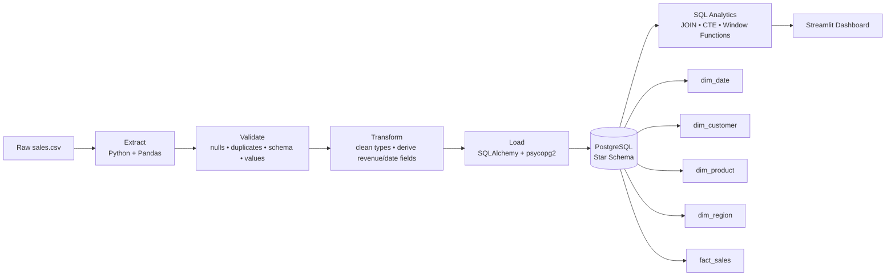
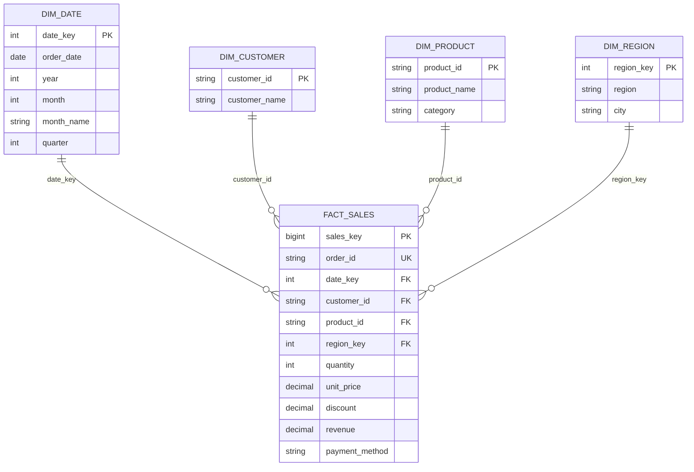

# System Architecture

## Star schema

## Data flow

1. **Extract** reads the raw CSV.
2. **Validate** checks required columns, nulls, duplicates, types and business-rule values.
3. **Transform** standardizes dates/numerics and prepares dimension/fact attributes.
4. **Load** truncates the warehouse tables and reloads the current dataset through SQLAlchemy.
5. **Analytics SQL** uses joins, CTEs, aggregation and window functions.
6. **Dashboard** queries PostgreSQL and exposes filters and KPIs through Streamlit.
